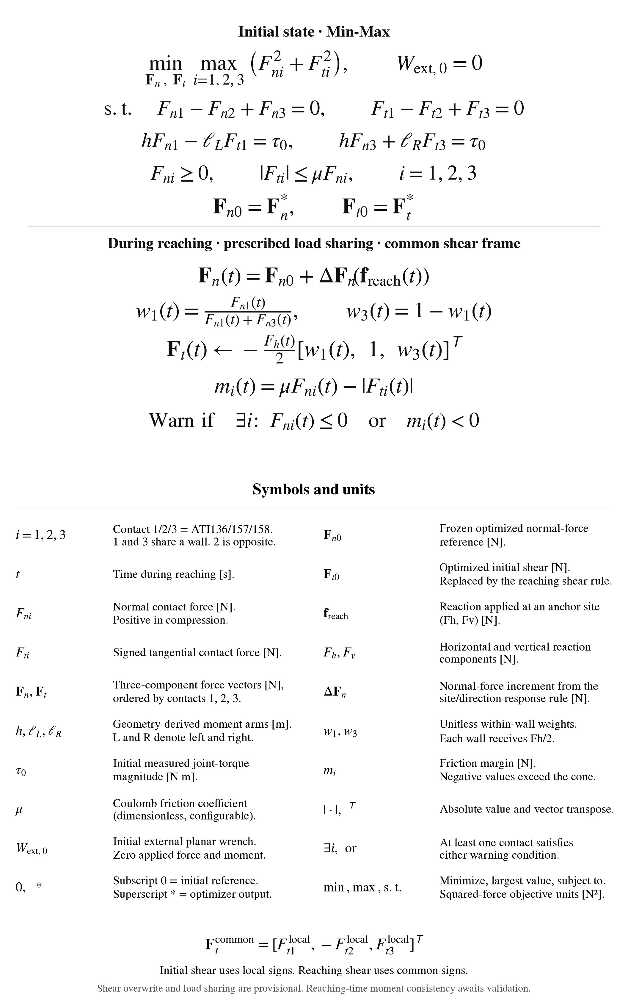

# Analytical anchoring calculation and tracking

The workflow computes and stores the complete initial Min-Max contact-force
state. During reaching, normal forces receive increments from that reference
and the shear rule overwrites initial shear. The tracker checks contact loss
and friction-cone exceedance.

## Run the examples

Run these commands from the repository root with Python 3.11 or newer.

```sh
python -m pip install -r anchoring_models/requirements.txt
python -m anchoring_models --config anchoring_models/examples/contact1_config.json --input anchoring_models/examples/synthetic_reaction.csv --output anchoring_models/outputs/contact1
python -m anchoring_models --config anchoring_models/examples/reaching_config.json --input anchoring_models/examples/synthetic_joints.csv --joint-input --output anchoring_models/outputs/reaching
python -m unittest discover -s anchoring_models/tests -v
```

The example CSVs contain synthetic samples. The contact-1 initialization uses
the numerical geometry and feedback-torque inputs from the existing T13 replay.
The reaching example exercises the joint-input interface using prescribed
states and torques. These examples demonstrate the calculation interfaces.

Each run writes `initial_state.json`, `tracking.csv`, `summary.json` and
`six_channel_timeline.png`. The complete initial six-force optimum remains
available in `initial_state.json`, including the complete initial shear.
At each reaching sample, the shear rule assigns the current tangential forces.
For a zero horizontal reaction, this assignment produces zero shear.

## Inputs

For reaction replay, supply the following CSV columns.

| Column | Meaning | Unit |
|---|---|---|
| `time_s` | Strictly increasing sample time | s |
| `Fh_N` | Signed horizontal reaction increment at the anchor | N |
| `Fv_N` | Signed normal-axis reaction increment at the anchor | N |
| `M_Nm` | Optional applied planar couple | N m |
| `measured_Fn1_N` through `measured_Ft3_N` | Optional measured six-channel overlays | N |

Reaction increments are relative to the no-external-wrench baseline. Subtract
the appropriate instrument offset before supplying a recorded gauge signal.
For the existing positive 45-degree contact-1 pulling replay,
`Fh_N = Fv_N = (gauge_N - baseline_N) / sqrt(2)`.

For joint replay, supply `time_s`, `q1` through `q6` in radians, `dq1` through
`dq6` in rad/s, and measured `tau1` through `tau6` in N m. The physical
base-to-tip order is RUC-016, RUC-001, RUB-017, RUC-009, RUC-012, RUC-011.
The reaching example attaches signs `[-1,+1,-1,+1,-1,+1]` to those named axes
and applies the same signs to q, dq and torque. Use all +1 signs for inputs
already expressed in the model convention.

Link 1 at zero angle points along +X. Each reaching link defaults to a uniform
0.5 kg rod of length 0.11 m. Configuration supports explicit length, mass,
axis-sign and yaw vectors or values. The fixed J1 base maps to `Rnext2`.
The default yaw of zero follows the previous provisional frame alignment.
Measured states require an experimentally checked frame transformation for
physical interpretation.

The anchor `initial.q_rad` is the already converted geometry angle. The caller
supplies the applicable HEBI or Scope conversion. Its geometry uses the existing
L = 0.1021 m and r = 0.0167 m defaults. A configuration can instead supply
`initial.geometry` with `h_m`, `left_arm_m` and `right_arm_m` explicitly.
The anchoring torque is the magnitude of the supplied measured feedback torque.
Choose the initial torque-peak sample before replay and retain it throughout.

## Preserved response rules

| Mode | Application site | Normal response | Common shear response |
|---|---|---|---|
| `contact1_transfer_weighted` | `ATI136` | Fn1 decreases, Fn3 and Fn2 increase by Fv | Two walls share Fh equally, contacts 1/3 use current normal-force weights |
| `legacy_site_linear` | `Rpre1` or `Rnext2` | Fv unloads contact 1 or 3, respectively | Fixed shares 1/4, 1/2, 1/4 |

The weighted rule reproduces the current T13/T14 45-degree pulling replay.
The site-linear rule preserves the earlier reaching Base/J1-to-Rnext2
postprocessor. Their application points and normal responses are configured
explicitly. The joint-input CLI selects the existing Rnext2 site-linear path.

Each time step starts from the same reference. Contact forces do not accumulate
across time. The tracker retains the first warning until a new tracker is
initialized. It preserves negative normal-force demands and cone violations.
After the first warning, the algebraic response can be inspected as a demand
curve. A post-slip contact-motion model remains a separate modeling task.

## Python interface

```python
from anchoring_models import Geometry, solve_initial, ContactTracker, Redistribution

geometry = Geometry.from_configuration(q_rad=0.65)
initial = solve_initial(geometry, measured_torque_Nm=-2.5, mu=0.5)
tracker = ContactTracker(initial, Redistribution("legacy_site_linear", "Rnext2"))
snapshot = tracker.update(time_s=0.01, Fh_N=5.0, Fv_N=2.0, M_Nm=0.1)
print(snapshot["Fn_N"], snapshot["Ft_common_N"], snapshot["warning_latched"])
```

All calculations run offline. The package has no hardware communication or
robot-controller imports. An integration can supply one reaction snapshot per
call through `ContactTracker.update`.

## Mathematical model and symbols

The [animated algorithm and free-body diagram](docs/figures/anchor_pseudocode_free_body.gif)
walk through the full initial state, normal-force increments, shear overwrite,
margin evaluation and warnings. Blue arrows show normal forces, orange arrows
show shear, green shows the applied reaction and gray shows initial shear.
The two illustrative reaction cases use synthetic inputs at ATI136 and mu=0.5.
They show friction exceedance and normal contact loss with fixed schematic
geometry. The response moment-balance assumption remains under validation.

```sh
python anchoring_models/scripts/render_workflow_demo.py
```

The generator writes the GIF, representative frames, per-frame force values and
its parameter audit to `anchoring_models/outputs/workflow_demo/`.

See [the complete equations and assumptions](docs/MODEL.md) and
[the regression record](docs/VALIDATION.md).



The [compact PNG](docs/figures/compact_initial_reaching.png) and
[annotated SVG](docs/figures/compact_initial_reaching_annotated.svg) support slides.
Regenerate both figures with the following commands.

```sh
python anchoring_models/scripts/draw_compact_initial_reaching.py
python anchoring_models/scripts/draw_annotated_initial_reaching.py
```

## Interpretation

The Min-Max initialization enforces the original two-body force and moment
equations, unilateral contact and Coulomb friction. It retains the native
contact-frame shear signs.

Shear overwrite and reaching-time load redistribution are provisional
assumptions. The response exposes global force residuals, the applied moment
left unmapped by the force-sharing rule, and an explicit false value for full
two-body moment-equilibrium verification. Cone membership alone supports a
contact-admissibility check. Closed-loop slip prevention requires additional
experimental validation.

The dynamics engine retains zero in-plane gravity, a fixed base, uniform rods
and instantaneous torque-driven acceleration. Joint friction, rotor inertia,
extra reaching contacts and thermal torque bias require additional modeling.
The supplied `M_Nm` is retained in the results. Its effect on contact forces
requires a separate moment-response model.
